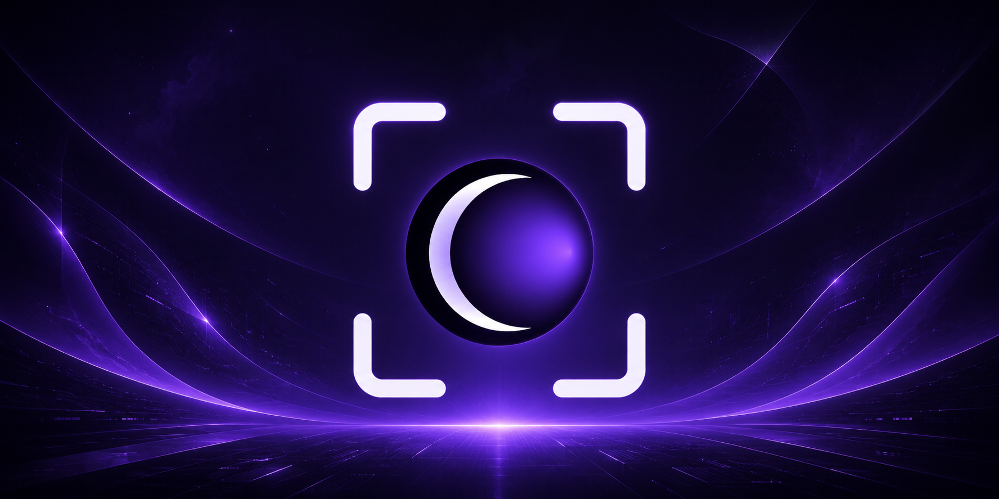

  

<h1 align="center">BlindSpot</h1>

  <em>AI answers for anything you select. invisible to screen recorders.</em>

  
  
  
  

Select any text, press **⌘⇧Space**, and an answer streams back in a floating overlay that no screenshot tool or screen recording can capture. Press **⌘⇧⌥Space** to include a screenshot for visual context.

---

## Install

1. Go to the [latest release](https://github.com/Nainounen/blind-spot/releases/latest)
2. Download `BlindSpot-<version>.dmg`
3. Open the DMG and drag **BlindSpot** to **Applications**
4. Launch it normally

BlindSpot is signed with an Apple Developer ID and notarized by Apple, so it opens without any Gatekeeper warnings.

**Requires macOS 26 or later. Works on Apple Silicon and Intel.**

---

## Setup

On first launch, BlindSpot guides you through setup:

1. **Choose a provider**. OpenAI, Anthropic, Gemini, DeepSeek, Grok, OpenRouter, or Ollama (local, no key needed)
2. **Paste your API key**. saved on your Mac only, never sent anywhere except your chosen provider
3. **Allow Accessibility access**. required to read selected text and listen for hotkeys
4. **Allow Screen Recording**. needed for visual context screenshot (⌘⇧⌥Space), prompted on first use

Once done, the **✦** icon appears in your menu bar.

---

## Profiles and context files

Each profile has its own provider, model, custom instructions and generation settings. Switch profiles from the menu bar or chat panel.

In **Settings → Profiles → Context Files**, click **Open in Finder** to open the selected profile’s context folder.

- Use any filename, such as `course-notes.txt` or `project.xml`.
- Supported extensions: `.md`, `.markdown`, `.txt`, `.html`, `.htm` and `.xml`. Files must use UTF-8 encoding. HTML and XML are included as text; they are not rendered or executed.
- Normal chats load context at the start of a conversation and retain it for follow-ups. Start a new chat after editing or archiving files.
- Auto-Answer rereads context for every question and uses the active profile’s instructions. Required answer formatting takes precedence so the response can be filled correctly.
- Only files directly in the context folder are included. Move old files into an `archive/` subfolder to keep them without sending them in new requests.
- PDF context files are not supported.

## Auto-Answer (beta)

Press **⌘⌥A** with a Classtime question active. BlindSpot reads the current question, asks your active profile’s model, and fills the response without submitting it.

For extension-free support, use Chrome, Chromium, Brave, Edge or Ego Lite:

1. Enable **View → Developer → Allow JavaScript from Apple Events** in the browser.
2. Allow BlindSpot to control that browser under **System Settings → Privacy & Security → Automation** when prompted.
3. Keep the same question and browser tab active while the answer is generated.

Supported controls include single and multiple choice, text, rich-text editors, ordering, category tables and gap fills. Cloze support depends on the page exposing verifiable selection state. A small indicator follows the pointer while Auto-Answer works and follows the panel’s Light, Dark or System appearance. It does not take focus or intercept clicks.

Successfully filled Classtime questions are grouped into a chat titled **Auto-Answer: Classtime …** for the same browser tab and participant session. Different profiles have separate histories. Restarting the browser or using another tab starts a separate group. Answers appear as readable text, including selected options and ordered items. The older Accessibility path saves generated answers by run and labels them as unverified fills.

Open the session in the chat sidebar to review, continue or export it as Markdown or JSON. Session history records generated answers; it does not mean the answers are correct or submitted. The Classtime adapter does not support session-wide Answer All. The **⌘⌥⇧A** shortcut remains available for the older Accessibility-based workflow on other pages.

## Conversation history and export

The chat panel saves conversations locally and supports folders, search and exports.

- Click a conversation to open it. **⌘-click** selects multiple conversations; **Shift-click** selects a range.
- With the sidebar list focused, **⌘A** selects all conversations, or all matching conversations when searching. In a text field, ⌘A still selects text.
- Use the selection toolbar or right-click menu to move selected conversations into a folder or remove them from a folder.
- Delete selected conversations together after confirming, or export the selection as Markdown or JSON.
- Right-click a folder to rename it, export its conversations or remove the folder. Removing a folder keeps its conversations.

Sparkle checks for updates and displays the release changelog in the update window.

---

## Shortcuts

| Shortcut | Action |
|---|---|
| ⌘⇧Space | Ask about selected text |
| ⌘⇧⌥Space | Ask with visual context. captures a screenshot around the selection |
| ⌘⌥A | Auto-Answer the current question |
| ⌘⌥⇧A | Answer All through Accessibility (not supported for Classtime sessions) |
| ⌘N | New conversation |
| ⌘K | Focus search |
| ⌘W | Close the panel |
| ESC | Close the panel |
| ⌘⌥Q | Force-quit |

Global shortcuts are configurable in Settings → Hotkeys.

---

## Visual Context

Press **⌘⇧⌥Space** to include a screenshot of the area around your selected text. The AI sees the visual context. UI, diagrams, code layout, tables. alongside the text.

- Captures a padded region around the selection using ScreenCaptureKit
- Works with any vision-capable provider (Gemini, GPT-4o, Claude, Grok)
- Each profile can optionally route vision requests through a **different provider or model**. for example, text via DeepSeek and vision via Gemini
- Padding and minimum capture size are configurable in Settings → Preferences
- A minimap preview shows how much of your screen the capture covers

---

## AI providers

| Provider | Default model | API key |
|---|---|---|
| OpenAI | GPT-4o | [platform.openai.com/api-keys](https://platform.openai.com/api-keys) |
| Anthropic | Claude Sonnet | [console.anthropic.com/settings/keys](https://console.anthropic.com/settings/keys) |
| Google Gemini | Gemini 2.5 Flash | [aistudio.google.com/app/apikey](https://aistudio.google.com/app/apikey) |
| DeepSeek | deepseek-v4-flash | [platform.deepseek.com/api_keys](https://platform.deepseek.com/api_keys) |
| xAI Grok | Grok 3 | [console.x.ai](https://console.x.ai) |
| OpenRouter | GPT-4o (via OR) | [openrouter.ai/keys](https://openrouter.ai/keys) |
| Ollama | Llama 3.2 | No key. runs entirely on your Mac |

---

## Privacy

- API keys are stored at `~/.config/blind-spot/keys/` and sent only to your chosen provider
- Selected text goes to your provider's API; their privacy policy applies
- The overlay is excluded from screen capture via `NSWindowSharingNone` at the compositor level. it does not appear in screenshots, ScreenCaptureKit recordings, or video calls (Zoom, Teams, Meet, etc.)
- Screen Recording permission is requested only when using visual context (⌘⇧⌥Space) to capture the area around your selection
- No Dock icon. No analytics. No data collection.

### Where data is stored

| Path | Contents |
|---|---|
| `~/.config/blind-spot/keys/<provider>` | API key for each provider (mode 0600) |
| `~/.config/blind-spot/profiles.json` | AI profiles. provider, model, system prompt, temperature, token limit |
| `~/.config/blind-spot/context/<profile-id>/` | Per-profile context files; subfolders are ignored |
| `~/.config/blind-spot/conversations/` | Conversation history (JSON, one file per conversation) |
| `~/.config/blind-spot/system-prompt.txt` | Legacy global system prompt (migrated to profiles on first run) |
| `~/Library/Preferences/com.blind-spot.app.plist` | App preferences. active profile, hotkeys, toggles |

Profiles and conversation history are stored locally and are not synced. Questions, included context files and any requested screenshots are sent to the configured AI provider when you ask for an answer.

---

## Contributing

See [CONTRIBUTING.md](CONTRIBUTING.md) for how to build from source and submit changes.
